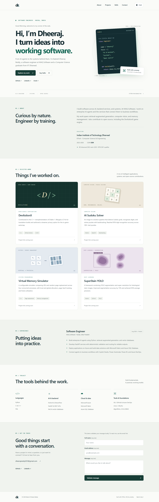

# Dheeraj Reddy — Personal Portfolio

A responsive personal portfolio for Badveli Dheeraj Reddy, Software Engineer at MAQ Software and Computer Science graduate from IIT Dharwad. Built for the HTML, CSS & JavaScript bootcamp assignment.

## Features

- Home, About, Projects, Experience, Skills, and Contact sections.
- Four projects from my resume, with clearly labelled project-link placeholders.
- Light and dark themes with a saved preference; follows the system theme until a preference is selected.
- A greeting based on the visitor's local time, refreshed every minute.
- A welcome message triggered by the **Say hello** button.
- Contact validation for missing fields, whitespace-only input, and email format, with inline errors and success feedback.
- Responsive layouts, keyboard focus states, a skip link, labelled fields, live status messages, and reduced-motion support.
- CSS illustrations and a local SVG favicon; no external fonts or image dependencies.

## Technologies

HTML5, CSS3 (Grid, Flexbox, custom properties, and media queries), and vanilla JavaScript (ES6+). No frameworks, runtime libraries, backend, or build step are required.

## Run locally

Clone the repository and open `index.html` in a modern browser:

```sh
git clone https://github.com/dheeraj-droid/personal-portfolio.git
cd personal-portfolio
```

Alternatively, serve the directory with Python:

```sh
python -m http.server 8000
```

Then open `http://localhost:8000`. Theme storage on direct `file:` URLs can vary by browser; a local server provides a consistent origin.

## Project structure

```text
personal-portfolio/
├── index.html
├── css/style.css
├── js/script.js
├── assets/
│   ├── images/favicon.svg
│   └── screenshots/
│       ├── desktop.png
│       ├── dark.png
│       └── mobile.png
├── README.md
└── ai-usage.md
```

## Screenshots

[Desktop, light theme](assets/screenshots/desktop.png) · [Desktop, dark theme](assets/screenshots/dark.png) · [Mobile](assets/screenshots/mobile.png)



## Verification

Automated interaction checks ran in headless Microsoft Edge using Playwright during development. Playwright and the formatter are local development tools only; the website does not load them.

Passed checks:

- All section anchors resolve, and main navigation reaches each target.
- Welcome interaction shows a message.
- Morning, afternoon, and evening greeting branches display correctly.
- Theme switches both ways and persists after reload.
- Empty fields, whitespace-only names/messages, and malformed emails are rejected.
- Valid input displays success; repeated submissions display a single explanatory status.
- Editing a validated message clears stale success feedback.
- Invalid submission focuses the first invalid field; keyboard navigation reaches the skip link.
- No horizontal overflow at 320, 375, 768, 1024, and 1440px in light mode, and 320, 375, 768, and 1440px in dark mode.
- No browser JavaScript or console errors during the tested flow.
- With JavaScript disabled, content and navigation remain available, and the demo form is disabled with an email alternative.

The generated desktop, dark-theme, and mobile screenshots were visually reviewed. JavaScript syntax was checked with `node --check js/script.js`.

### Manual review checklist

1. Open the page and visit About, Projects, Skills, and Contact.
2. Click Say hello and toggle the theme twice.
3. Reload and confirm the selected theme remains active.
4. Submit an empty form, then try whitespace-only fields and an invalid email.
5. Enter valid details, submit, and submit again; check the feedback.
6. Use Tab and Shift+Tab through navigation, buttons, and form controls; confirm visible focus.
7. Review the page on mobile, tablet, and desktop, including a real touch device if available.

## Limitations

- The contact form is a local demonstration. It validates input but does not send or store messages. Use the email link to contact me.
- Individual project links intentionally say **Project link coming soon**. These are noninteractive labels, not dead links.
- Project descriptions and performance figures come from my supplied resume; the portfolio does not independently reproduce those benchmarks.
- Browser checks used Edge with emulated viewport sizes. Safari, Firefox, real-device touch behavior, and a full screen-reader audit have not been verified.
- The portfolio is ready for static hosting; hosting configuration is separate from the source repository.

See [ai-usage.md](ai-usage.md) for the AI assistance disclosure.
